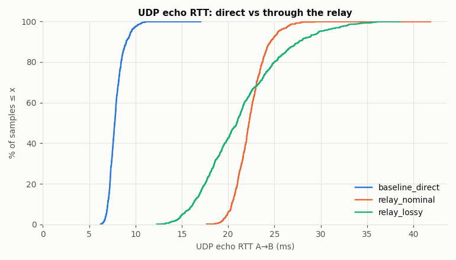
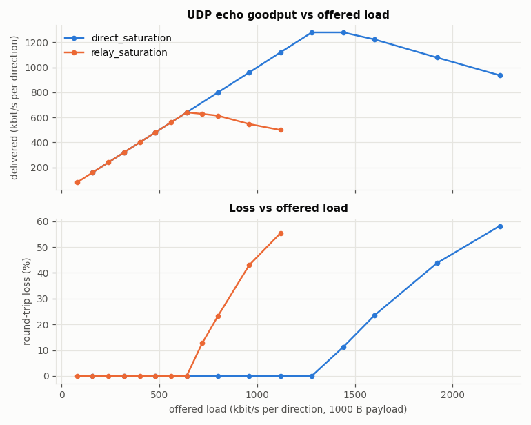

<!--
Copyright 2026 siraisisatoru
SPDX-License-Identifier: Apache-2.0
-->

# Host network simulation: results

Generated by `sim/run_sim.sh` on 2026-11-03 (kernel 7.0.12-linuxkit). The model and its assumptions are described in [../README.md](../README.md). These are model numbers for planning and for checking the tooling, not measurements of the boards.

Timer calibration: each netem stage in this VM adds about 0.35 ms, which is subtracted from every configured hop delay.

## Scenarios

| Scenario | Topology | What it models |
|---|---|---|
| [baseline_direct](baseline_direct/) | direct | Reference: node A associated straight to node B (one hop, every frame takes airtime once). Same radio and traffic as relay_nominal. |
| [relay_nominal](relay_nominal/) | relay | Two clean hops through the single-radio repeater; also measures the A-relay hop on its own (UDP echo to the relay and ping). |
| [relay_lossy](relay_lossy/) | relay | 3 % residual frame loss per hop and direction (after MAC retries) and 2 ms jitter per hop. Round-trip loss over four hop traversals should be about 1 - 0.97^4 = 11.5 %. |
| [relay_outage](relay_outage/) | relay | The relay's uplink to node B is black-holed (100 % loss both ways) from t=20 s for 15 s while every interface and association stays up. This models an outage shorter than beacon-loss detection, NOT the relay losing the root: on the EKH05 that also takes the relay's own IP down and, after the 10 s recovery timeout, tears down the relay AP and node A's association (see sim/README.md, Hardware differences). Checks UDP loss accounting and TCP stall detection, backoff and reconnect. |
| [relay_saturation](relay_saturation/) | relay | 1000-byte UDP echo at increasing rate until the shared channel saturates (each echo crosses the air four times through the relay). TCP off; ping to B keeps running to show queueing delay. |
| [direct_saturation](direct_saturation/) | direct | Same sweep with node A straight to node B, to compare capacity with relay_saturation (expected about 2x). |

## Latency, loss and TCP recovery

UDP: 10 echo requests/s, 64 B payload. TCP: 5 messages/s, 256 B. Ping: every 200 ms, 56 B. UDP RTT percentiles are exact per-packet values from a capture on A; ping percentiles are from the ping samples.

| Scenario | UDP loss % (uplink %) | UDP RTT p50 / p95 / max (ms) | UDP jitter (ms) | A→relay UDP RTT p50 (ms) | ping A→B p50 / p95 (ms), loss % | TCP ACKed / sent | TCP reconnects | TCP recovery after link up (s) | goodput UDP / TCP (kbit/s) |
|---|---|---|---|---|---|---|---|---|---|
| baseline_direct | 0.00 (0.00) | 7.8 / 9.6 / 17.1 | 0.67 | - | 7.9 / 9.6, 0.0 | 300 / 300 | 0 | - | 5.1 / 10.2 |
| relay_nominal | 0.00 (0.00) | 22.3 / 25.4 / 41.3 | 1.60 | 11.6 | 21.2 / 24.4, 0.0 | 300 / 300 | 0 | - | 5.1 / 10.2 |
| relay_lossy | 11.89 (7.33) | 20.9 / 29.8 / 37.5 | 4.35 | 10.8 | 19.6 / 28.0, 11.1 | 450 / 450 | 0 | - | 4.5 / 10.2 |
| relay_outage | 16.67 (16.67) | 19.8 / 22.6 / 39.9 | 2.28 | 10.6 | 19.1 / 23.3, 16.3 | 372 / 397 | 1 | 0.67 | 4.3 / 8.5 |

### relay_outage timeline

- R-B link down at 20.01 s, up at 35.01 s.
- Longest gap between UDP echoes at A: 15.10 s; UDP lost 150 (uplink 150): every request sent while the link was down never reached B.
- TCP stall detected 5.05 s after the link went down (ack timeout 5 s); reconnected 0.67 s after it came back; outage seen by the client 10617 ms; 25 messages were outstanding at the drop and are counted as lost.
  - 1.06 s `connected` attempt=1, connect_ms=41, outage_ms=0
  - 25.06 s `disconnected` reason=stall, unacked=25, err=0, retry_ms=483
  - 30.55 s `connect_failed` attempt=2, err=110, retry_ms=995
  - 35.68 s `connected` attempt=3, connect_ms=4131, outage_ms=10617

## relay_saturation

Model capacity 81.3 echo/s; highest delivered 80.0 echo/s = 640.0 kbit/s of payload per direction; highest rate with < 1 % loss: 80 requests/s.

| Offered (req/s) | Offered (kbit/s per dir) | Delivered (echo/s) | Loss % | RTT p50 / p95 / max (ms) |
|---|---|---|---|---|
| 10 | 80 | 10.0 | 0.00 | 25.6 / 28.6 / 41.3 |
| 20 | 160 | 20.0 | 0.00 | 25.7 / 28.3 / 30.3 |
| 30 | 240 | 30.0 | 0.00 | 26.2 / 29.0 / 31.3 |
| 40 | 320 | 40.0 | 0.00 | 25.9 / 27.7 / 28.8 |
| 50 | 400 | 50.0 | 0.00 | 27.1 / 32.2 / 38.3 |
| 60 | 480 | 60.0 | 0.00 | 31.6 / 36.3 / 39.1 |
| 70 | 560 | 70.0 | 0.00 | 32.3 / 38.1 / 43.0 |
| 80 | 640 | 80.0 | 0.00 | 243.6 / 411.5 / 427.8 |
| 90 | 720 | 78.5 | 12.78 | 587.6 / 598.3 / 605.2 |
| 100 | 800 | 76.8 | 23.25 | 592.9 / 603.9 / 612.9 |
| 120 | 960 | 68.4 | 43.02 | 601.2 / 613.4 / 619.3 |
| 140 | 1120 | 62.4 | 55.45 | 608.5 / 616.3 / 619.5 |

## direct_saturation

Model capacity 162.7 echo/s; highest delivered 160.0 echo/s = 1280.0 kbit/s of payload per direction; highest rate with < 1 % loss: 160 requests/s.

| Offered (req/s) | Offered (kbit/s per dir) | Delivered (echo/s) | Loss % | RTT p50 / p95 / max (ms) |
|---|---|---|---|---|
| 20 | 160 | 20.0 | 0.00 | 11.6 / 13.3 / 18.6 |
| 40 | 320 | 40.0 | 0.00 | 11.2 / 12.9 / 14.4 |
| 60 | 480 | 60.0 | 0.00 | 11.0 / 12.7 / 14.8 |
| 80 | 640 | 80.0 | 0.00 | 11.2 / 12.9 / 14.8 |
| 100 | 800 | 100.0 | 0.00 | 11.3 / 13.3 / 16.7 |
| 120 | 960 | 120.0 | 0.00 | 12.6 / 16.5 / 19.0 |
| 140 | 1120 | 140.1 | 0.00 | 13.0 / 16.0 / 18.6 |
| 160 | 1280 | 160.0 | 0.00 | 17.1 / 18.9 / 21.6 |
| 180 | 1440 | 160.0 | 11.17 | 301.9 / 306.4 / 309.8 |
| 200 | 1600 | 153.0 | 23.50 | 304.7 / 308.3 / 311.6 |
| 240 | 1920 | 134.9 | 43.80 | 306.2 / 310.2 / 312.9 |
| 280 | 2240 | 117.1 | 58.19 | 307.2 / 310.7 / 313.8 |

## Checks

| Scenario | Check | Value | Expected | Result |
|---|---|---|---|---|
| baseline_direct | `flows.udp.loss_pct` | 0.000 | <= 0.5 | PASS |
| baseline_direct | `flows.tcp.disconnects` | 0 | <= 0 | PASS |
| baseline_direct | `flows.ping_node_b.loss_pct` | 0.000 | <= 1.0 | PASS |
| baseline_direct | bug #10 model active (self-test broadcast from B dropped) | 1 | >= 1 | PASS |
| baseline_direct | group-addressed frames B tried to send during the run (dropped) | 0 | info | - |
| relay_nominal | `flows.udp.loss_pct` | 0.000 | <= 0.5 | PASS |
| relay_nominal | `flows.tcp.disconnects` | 0 | <= 0 | PASS |
| relay_nominal | `flows.ping_node_b.loss_pct` | 0.000 | <= 1.0 | PASS |
| relay_nominal | `derived.relay_rtt_over_hop_rtt` | 1.919 | >= 1.5 | PASS |
| relay_nominal | bug #10 model active (self-test broadcast from B dropped) | 1 | >= 1 | PASS |
| relay_nominal | group-addressed frames B tried to send during the run (dropped) | 0 | info | - |
| relay_lossy | `flows.udp.loss_pct` | 11.889 | >= 7.0 and <= 16.0 | PASS |
| relay_lossy | `flows.udp_srv.loss_pct` | 7.333 | >= 3.0 and <= 9.0 | PASS |
| relay_lossy | `flows.tcp.acked_pct` | 100.000 | >= 90.0 | PASS |
| relay_lossy | bug #10 model active (self-test broadcast from B dropped) | 1 | >= 1 | PASS |
| relay_lossy | group-addressed frames B tried to send during the run (dropped) | 0 | info | - |
| relay_outage | `flows.udp.lost` | 150 | >= 140 and <= 175 | PASS |
| relay_outage | `flows.tcp.disconnects` | 1 | >= 1 | PASS |
| relay_outage | `flows.tcp.reconnects` | 1 | >= 1 | PASS |
| relay_outage | `derived.tcp_recovery_after_link_up_s` | 0.672 | <= 15.0 | PASS |
| relay_outage | `derived.udp_longest_gap_s` | 15.104 | >= 14.0 and <= 17.0 | PASS |
| relay_outage | bug #10 model active (self-test broadcast from B dropped) | 1 | >= 1 | PASS |
| relay_outage | group-addressed frames B tried to send during the run (dropped) | 0 | info | - |
| relay_saturation | `sweep.first_loss_pct` | 0.000 | <= 1.0 | PASS |
| relay_saturation | `sweep.last_loss_pct` | 55.446 | >= 5.0 | PASS |
| relay_saturation | `sweep.knee_over_model` | 0.984 | >= 0.75 and <= 1.25 | PASS |
| relay_saturation | bug #10 model active (self-test broadcast from B dropped) | 1 | >= 1 | PASS |
| relay_saturation | group-addressed frames B tried to send during the run (dropped) | 0 | info | - |
| direct_saturation | `sweep.first_loss_pct` | 0.000 | <= 1.0 | PASS |
| direct_saturation | `sweep.last_loss_pct` | 58.188 | >= 5.0 | PASS |
| direct_saturation | `sweep.knee_over_model` | 0.984 | >= 0.75 and <= 1.25 | PASS |
| direct_saturation | bug #10 model active (self-test broadcast from B dropped) | 1 | >= 1 | PASS |
| direct_saturation | group-addressed frames B tried to send during the run (dropped) | 0 | info | - |
| all | relay_nominal UDP RTT p50 > baseline_direct UDP RTT p50 | 22.3 ms vs 7.8 ms | | PASS |
| all | relay capacity / direct capacity about 0.5 (single-radio store-and-forward) | 0.50 | | PASS |
| all | relay_outage UDP loss matches the outage length | 150 lost = 15.0 s at 10 pps; outage 15.0 s | | PASS |

## Plots

- baseline_direct: [rtt_cdf.png](baseline_direct/rtt_cdf.png), [timeline.png](baseline_direct/timeline.png)
- relay_nominal: [rtt_cdf.png](relay_nominal/rtt_cdf.png), [timeline.png](relay_nominal/timeline.png)
- relay_lossy: [rtt_cdf.png](relay_lossy/rtt_cdf.png), [timeline.png](relay_lossy/timeline.png)
- relay_outage: [rtt_cdf.png](relay_outage/rtt_cdf.png), [timeline.png](relay_outage/timeline.png)
- relay_saturation: [rtt_cdf.png](relay_saturation/rtt_cdf.png), [saturation.png](relay_saturation/saturation.png), [timeline.png](relay_saturation/timeline.png)
- direct_saturation: [rtt_cdf.png](direct_saturation/rtt_cdf.png), [saturation.png](direct_saturation/saturation.png), [timeline.png](direct_saturation/timeline.png)
